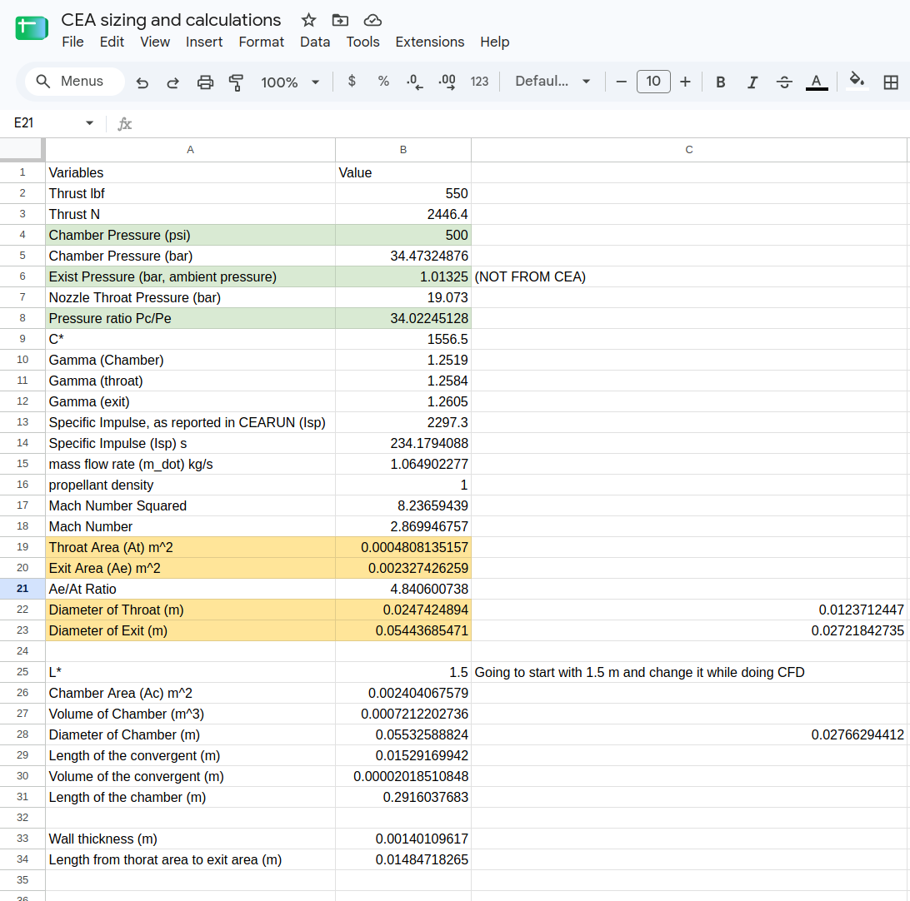

# Rocket Personal Projcet
### 2026-11-14
## What I hope to learn from this project
The goal of this project is to recreate UCSD SEDS's Moonshine rocket. 

I want to learn the skills of designing a rocket engine to hopefully get accepted into one of the rocketry clubs. 

## Objective 
Design everything of the rocket up until physically building the rocket. 
Including CEA (Chemical Equilibrium Analysis), CAD (Computer Aided Design), and CFD (Computational Fluid Dynamics).

## Parameters 
All the parameters are based on SEDS UCSD's Moonshine Block 1 engine.

| Parameters | Values |
| ---------- | ------ |
| Thrust | 550 lbF |
| Chamber Pressure | 500 PSI |
| Fuel | LOX/IPA (Isopropal Alcholol) |
| Chamber material | Stainless Steel |
| Ignition | Solid Ingiter |
| Cooling | Film Cooling |

## Build Log 1
You know that one meme of a fighter jet pilot reading a book that says "how to fly" while in the air? That was how I was feeling this entire time. 

To start I needed to do Chemical Equilibrium Analysis to size my nozzle and combustion chamber based on the fuel I'm using (LOX/IPA) and the target combustion chamber pressure (500 PSI). 

I started out knowing nothing about CEA, thankfully I reached out to a friend who is in SEDS who pointed me in the right direction, and told me that there is a free [website](https://cearun.grc.nasa.gov/) developed by NASA that can do CEA for you. (thanks Zander!)

In addition to that, I also found a [website](https://spacha.github.io/How-to-Rocket/) that has a tutorial for how to build a simple rocket engine, so I used the equation provided in there in addition to the data outputted by CEA to calculate the nozzle size + combustion chamber size. (I had to look up some equations, for example the cross-sectional area of the nozzle throat is too complcated so I used a equation with $C*$ in it: $A_t=\frac{\dot{m}C^*}{P_c}$ where $A_t$ is the throat cross-sectional area. $\dot{m}$ is the mass flow rate, $C*$ is the characteristic velocity, and ${P_c}$ is the chamber pressure) 

Initially the numbers looked really off, for some reason the cross-secional area for the nozzle exit is somehow the same size as the F-1 engine. It took me a while, but I found out that the main issue is units, none of the outputed values are in standard SI units, so I had to convert everything and the number made more sense. 

For the combustion chamber sizing, the $L^*$ or characteristic length of the chamber was apparantly different based on the fuel you use. I don't know why, maybe its because LOX/IPA is not practical in orbital vehicles, but I can't find any data on its $L^*$. I decided to set it at 1.5 meters and try to change it based on CFD results. 

Below is the spreadsheet I used to calculate the values of the nozzle and combustion chamber

Thanks for reading!