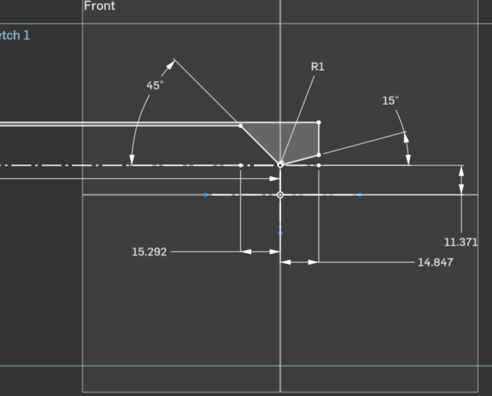
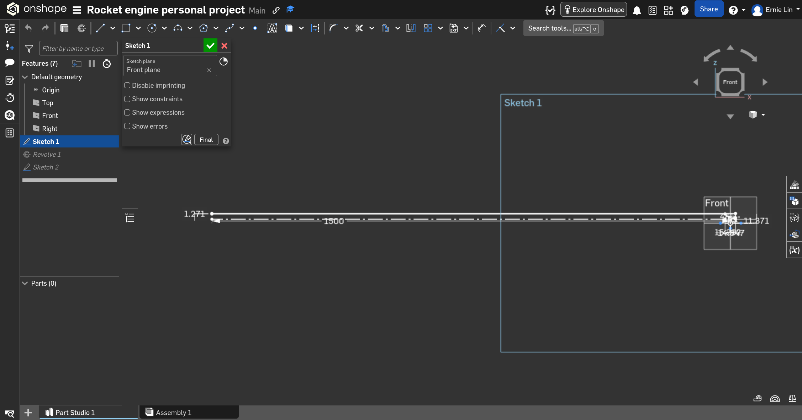
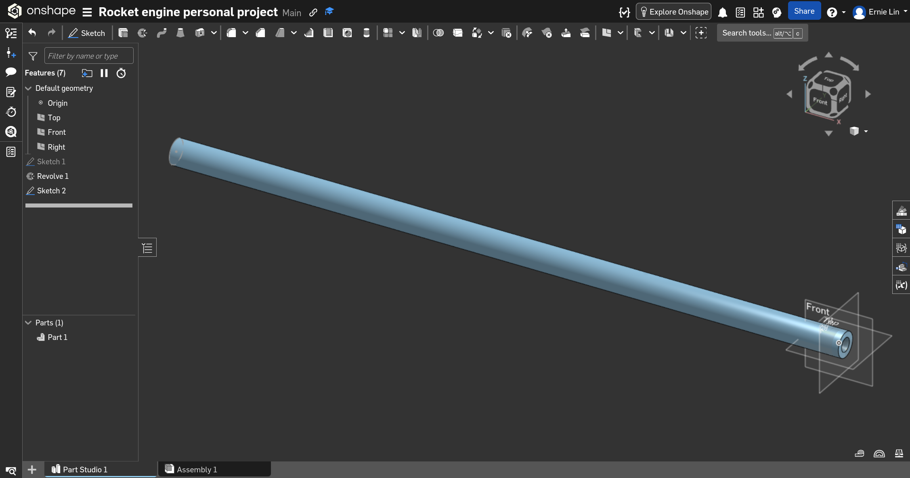

# Rocket Personal Projcet
*2026-11-14*
## Build log 2
Today I used the values I got from my CEA to CAD out the rocket engine, and realized a huge problem.

As you can see, the CAD showed that there is something seriously wrong with my sizing calculation, because the combustion chamber is way too long and narrow relative to the nozzle. 

I will have to go back to the spreadsheet to make sure that all my numbers are correct. I don't really know where to start looking though, so this could be an issue.

I'd also need to figure out the injectors too because I don't think I sized them yet, but the sizing issue is more pressing.

Thanks for reading!